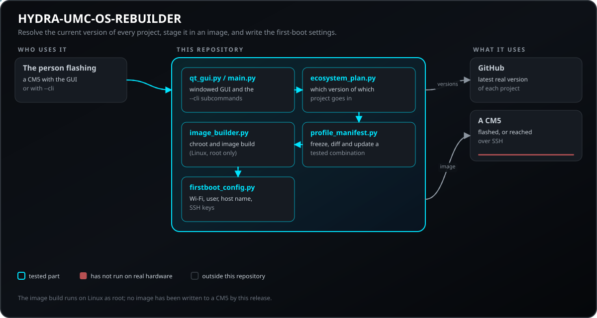
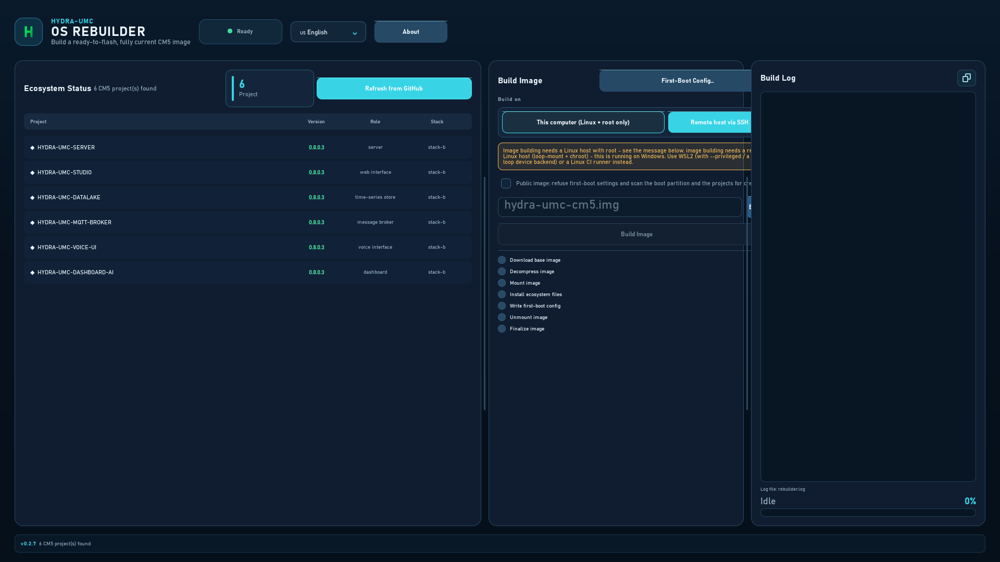
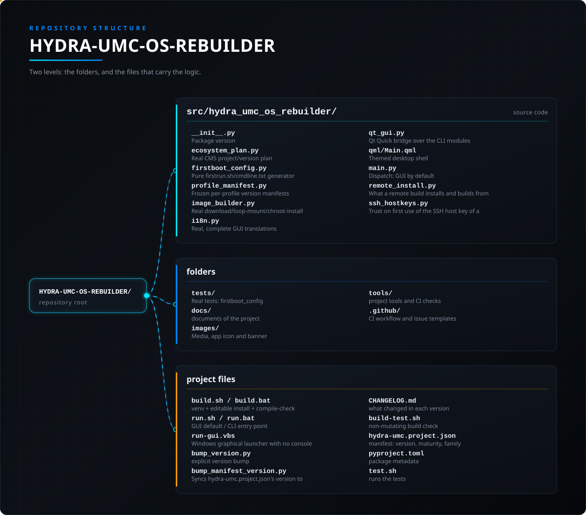

<!-- =============================================================================
HYDRA-UMC-OS-REBUILDER - Builds a ready-to-flash CM5 image
Copyright (C) JuanenRac (Electro Hobby 3D) <electrohobby3d@gmail.com>
GPL-3.0-or-later - see LICENSE
============================================================================= -->

<p align="center">
  
</p>

# 📀 HYDRA-UMC-OS-REBUILDER

<p align="center"><a href="README.md">🇺🇸 English</a> | <a href="README_spa.md">🇪🇸 Español</a> | <a href="README_fra.md">🇫🇷 Français</a> | <a href="README_ita.md">🇮🇹 Italiano</a> | 🇩🇪 <b>Deutsch</b> | <a href="README_zho.md">🇨🇳 简体中文</a> | <a href="README_jpn.md">🇯🇵 日本語</a> | <a href="README_por.md">🇵🇹 Português</a></p>

### 📀 Ein flashbereites, vollständig aktuelles CM5-Image erstellen

<p align="center">
  
  
  
  
  
  
  
</p>

---

> **Stand von Sicherheit (Safety) und Security:** Dieses Ökosystem ist kein zertifiziertes Sicherheitssystem. Es gibt noch keinen Hardware-E-STOP-Pfad, keine von der Firmware durchgesetzten Grenzen oder Verriegelungen und keinen verifizierten Bewegungsbefehl; Firmware-Images werden mit CRC-32 und einer Ed25519-Signatur geprüft, und ein Release-Build verweigert die veröffentlichten Entwicklungsschlüssel (die Werkzeugköpfe und Erweiterungsplatinen hinter dem Relais laufen noch mit URTC-Bootloadern, die statt einer Signatur ein HMAC-SHA256 mit gemeinsamem Schlüssel verwenden); TLS und gegenseitiges TLS sind optional und standardmäßig aus; noch keine eigene Platine wurde bestückt oder getestet. Lesen Sie die [Sicherheitsbasis](https://github.com/JuanenRac/HYDRA-UMC-DOCS/blob/main/docs/SECURITY_BASELINE.md) und das [Bedrohungsmodell](https://github.com/JuanenRac/HYDRA-UMC-DOCS/blob/main/docs/THREAT_MODEL.md), bevor Sie sich für die Sicherheit einer Person auf eine Aussage hier verlassen.

---

## 📋 Auf einen Blick

| | |
|---|---|
| Version | `0.3.3` |
| Reifegrad | Funktionsfähig |
| Tests | 194 (`python -m pytest -q tests`) |
| Technik | Python 3.10+ / PySide6 / QML / Raspberry Pi OS / GitHub raw content |
| Ziel | Der PC der Person, die es benutzt |
| Auf echter Hardware | Noch nicht: für diese Version ist kein Lauf auf echter Hardware vermerkt |

**Springe zu:** [Überblick](#-überblick) · [Architektur](#-architektur) · [Sicherheit und Schutz](#-sicherheit-und-schutz) · [Schnellstart](#-schnellstart) · [Tests](#-tests) · [Struktur des Repositorys](#-struktur-des-repositorys) · [Verwandte Projekte](#-verwandte-projekte)

## 🚦 Projektstatus

Jede Zeile ist ein Teil dieses Repositorys, und die Ampel sagt, wie weit er heute ist. Sie beruht auf dem, was das Repository zeigen kann (Tests, Builds, Läufe), nicht auf dem, was geplant ist.

🟢 Fertig und überprüft · 🟡 Funktioniert, mit bekannten Grenzen · 🟠 Teilweise fertig oder noch nicht überprüft · 🔴 Nicht gemacht oder funktioniert nicht

| Bereich | Stand | Was das hier bedeutet |
|---|---|---|
| Software | 🟡 | Funktioniert für seinen Hauptzweck; die Ehrlichkeitsprüfung oben nennt, was noch fehlt |
| Tests | 🟢 | 194 automatische Tests, bei jeder Änderung ausgeführt |
| Echte Hardware | 🔴 | Noch nicht: für diese Version ist kein Lauf auf echter Hardware vermerkt |
| Dokumentation | 🟢 | README in acht Sprachen, bei jeder Änderung gegen das Manifest geprüft |

## 🎯 Überblick

HYDRA-UMC-OS-REBUILDER ist ein Windows/Linux-Desktop-Tool - standardmäßig
mit Fenster-GUI, vollständige CLI mit `--cli` - das die Frage beantwortet,
die jede reale CM5-Bereitstellung irgendwann braucht: **"Baue mir ein
frisches SD-Karten-/eMMC-Image, mit der aktuellsten echten Version jedes
Ökosystem-Projekts bereits installiert, und lass mich WLAN/Benutzer/
Hostname/SSH einstellen, bevor ich es schreibe."**

**Was das Image enthält:** die Projektkopien unter `/opt/hydra-umc/<Name>` in den geplanten Versionen und das, was der eigene Build jedes Projekts dort erzeugt hat. Es legt weder Dienstbenutzer noch systemd-Units an und richtet `/etc/hydra-umc` nicht ein; beim ersten Start startet also kein Dienst von selbst, und die Provisionierungsskripte von HYDRA-UMC-OS müssen weiterhin auf dem Board ausgeführt werden.

Es tut drei echte Dinge:

1. **Prüft GitHub.** Jedes Repository im HYDRA-UMC/URTC-Ökosystem, dessen
   eigene `hydra-umc.project.json`
   `"deployment_target": "cm5"` deklariert, wird dynamisch entdeckt (nie
   eine feste Liste) und dessen aktuell veröffentlichte Version gelesen -
   indem es sich auf `hydra-umc-updater` als echte Bibliothek dafür
   verlässt, nicht auf eine zweite, unabhängig driftende
   Neuimplementierung des eigenen Erkennungscodes.
2. **Baut ein echtes Image.** Lädt ein fixiertes, checksummenverifiziertes
   Raspberry-Pi-OS-Basisimage herunter, mountet es per Loop-Device und
   installiert/aktualisiert jedes entdeckte Projekt, indem **das eigene
   `build.sh` dieses Projekts** innerhalb des Chroot des Images ausgeführt
   wird - niemals eine Neuimplementierung der eigenen Build-Schritte
   irgendeines Projekts.
3. **Schreibt echte Ersteinrichtungs-Konfiguration.** Hostname, ein neuer
   Benutzer mit einem echt mit `passlib` gehashten Passwort, WLAN,
   Zeitzone, Tastaturlayout und SSH - derselbe echte `firstrun.sh`-
   Mechanismus, den der eigene "OS Customisation"-Bildschirm von
   Raspberry Pi Imager auf einem Raspberry-Pi-OS-Image (Trixie und
   neuer) verwendet, sodass sich die resultierende SD-Karte genau so
   verhält wie eine, die Raspberry Pi Imager selbst erzeugt hätte. Siehe
   [docs/FIRST_BOOT_CONFIG.md](docs/FIRST_BOOT_CONFIG.md).
4. **Prüft die eigene Ausgabe vor der Freigabe.** Bevor das erstellte
   Image an seinen endgültigen Pfad verschoben wird, wird das gemountete
   Root-Dateisystem auf ein echtes, in `wpa_supplicant.conf`/einem
   NetworkManager-Verbindungsprofil zurückgelassenes WLAN-Passwort, einen
   echten privaten SSH-Schlüssel, eine nicht leere Shell-Historie oder
   eine verirrte `.env`-Datei geprüft - jeder echte Fund blockiert die
   Freigabe vollständig, genau wie es ein Bereinigungsfehler bereits tut.
   Die Prüfsummenverifikation deckte nur den EINGANG (das Basis-Image)
   ab; dies ist die erste Prüfung dessen, was der Build-Vorgang selbst im
   AUSGANG hinterlässt.

```
$ hydra-umc-os-rebuilder --cli status
HYDRA-UMC-SERVER 0.4.8 (api/node)
HYDRA-UMC-VISION-STREAMER 0.0.3 (service/python)
HYDRA-UMC-GATEWAY-INDUSTRIAL 0.0.3 (api/node)
...
TOTAL=27

$ hydra-umc-os-rebuilder --cli config --out ./boot \
    --hostname hydra-umc-cm5 --username hydra-umc --password 'aendern' \
    --wifi-ssid MeinNetz --wifi-password 'wlan-pass' --wifi-country DE
CONFIG_WRITTEN out=boot firstrun=firstrun.sh
```

Ohne Argumente gestartet, öffnet es dieselben Informationen in einer Qt
Quick-Desktop-Oberfläche - unter Wiederverwendung derselben visuellen
Sprache wie HYDRA-UMC-UPDATER (gleiche dunkle Palette, Typografie und
Komponenten-Set) auf drei Tabs: Ökosystem-Status, Image erstellen und
Ersteinrichtung.

## 🧩 Rolle in HYDRA-UMC

**HYDRA-UMC-OS-REBUILDER** baut ein frisches CM5-Image, auf dem die aktuelle Version jedes Ökosystem-Projekts schon liegt, und schreibt die Einstellungen für den ersten Start (WLAN, Benutzer, Hostname, SSH), bevor das Image geflasht wird. Die Plattformschicht, die dieses Image trägt, beschreibt `HYDRA-UMC-OS`.

## 🏛️ Architektur

<p align="center">
  
</p>

### ARCHITEKTUR UND DESIGN-ENTSCHEIDUNGEN

- **SSH-Hostschlüssel beim ersten Mal festgehalten und kein Standard-WLAN-Land.** Ein Remote-Build lehnt einen Rechner ab, dessen Schlüssel er nicht festgehalten hat, und zeigt den SHA-256-Fingerabdruck des Schlüssels; gibt man diesen Fingerabdruck ein (am Rechner selbst geprüft), wird der Schlüssel festgehalten, danach wird nur noch dieser akzeptiert und ein anderer als geänderter Schlüssel abgelehnt. Der WLAN-Ländercode des Images hat keinen Standardwert mehr (`--wifi-country` / das Länderfeld ist bei einem WLAN Pflicht), weil er die Funkregeln des Landes festlegt, in dem der Rechner steht.
- **`ecosystem_plan.py` implementiert die GitHub-Erkennung niemals neu.**
  Es hängt von `hydra-umc-updater` als echtem Python-Paket ab
  (`hydra_umc_updater.github_client.discover_remote_projects()`) statt
  von einer zweiten Kopie seiner Manifest-Validierungs-/Retry-/Backoff-
  Logik - eine dort vorgenommene Korrektur oder Verbesserung kommt diesem
  Tool automatisch zugute.
- **`image_builder.py` implementiert den Build eines Projekts niemals
  neu.** Jedes Ökosystem-Projekt wird bei seiner eigenen echten fixierten
  Version geklont und durch Ausführen SEINES EIGENEN `build.sh`, im
  Chroot des Ziel-Rootfs, gebaut - dasselbe Prinzip "an das eigene
  Build-Skript jedes Projekts delegieren", das bereits das eigene
  `install.py` von `hydra-umc-updater` dokumentiert.
- **Die Linux/Root-Plattformgrenze wird immer zuerst geprüft.**
  `check_build_platform()` ist das Allererste, was `build_image()` tut -
  ein Build, der auf einem nicht unterstützten Host (Windows, ein
  Linux-Benutzer ohne Root, ein fehlendes `losetup`/`chroot`) still
  no-op'd, wäre schlimmer als einer, der mit einem klaren Grund die
  Ausführung verweigert.
- **`firstboot_config.py` ist ein reiner Generator ohne Nebeneffekte.** Es
  erzeugt nur reinen Textinhalt (einen `firstrun.sh`-String, einen
  `cmdline.txt`-Patch-String) - es berührt niemals ein echtes Image oder
  Dateisystem selbst, sodass es ohne Root oder ein echtes Image trivial
  testbar bleibt. Nur `image_builder.py` ist dafür verantwortlich, diesen
  Inhalt tatsächlich auf eine echte Boot-Partition zu schreiben.
- **Eine Firstboot-Konfiguration, die den Bediener aussperren würde, wird abgelehnt, nicht gebaut.** SSH zu deaktivieren, ohne dass ein Konto konfiguriert wird, lässt die eigenen offiziellen Basis-Images dieses Tools (kein Standardbenutzer ab Trixie) ganz ohne Anmeldeweg - es wird abgelehnt, außer `acknowledge_no_remote_access=True` stimmt ausdrücklich zu. `describe_recovery_procedure()` nennt den echten Wiederherstellungsweg für alles, was die Konfiguration offen lässt.
- **Ein eingefrorenes Profil ist ein echtes, gespeichertes Rezept, das nie neu abgerufen wird.** `freeze_profile()` und `profile-build` aus `profile_manifest.py` pinnen jedes Projekt auf den exakten Commit-SHA, mit dem es getestet wurde - ein späterer Build ersetzt nie stillschweigend, was GitHub gerade „latest“ nennt. `diff_profile()` vergleicht ein eingefrorenes Profil pro Projekt (nicht als einzelnen Wahrheitswert) mit dem laufenden Ökosystem.
- **Die Passwörter werden nicht mehr als Argumente übertragen.** `--password` und `--wifi-password` funktionieren weiter, aber eine Befehlszeile ist für jeden Benutzer der Maschine sichtbar und `sudo` schreibt sie ins Authentifizierungsprotokoll; die CLI liest sie daher auch aus `HYDRA_UMC_FIRSTBOOT_PASSWORD` / `HYDRA_UMC_FIRSTBOOT_WIFI_PASSWORD` oder mit `--secrets-stdin` aus einem JSON-Objekt (`{"password": "...", "wifiPassword": "..."}`) auf der Standardeingabe. Der Remote-Build (SSH) der GUI sendet sie so und setzt sie nicht mehr in den ausgeführten Befehl.
- **Der Chroot ist vollständig und der Remote-Build festgelegt.** Der Build hängt `/proc`, `/sys`, `/dev` und `/dev/pts` in das Image ein und gibt ihm die Namensauflösung des Rechners, solange die Projekte gebaut werden (die eigene `resolv.conf` des Images wird danach zurückgelegt); so erreichen `pip`, `npm` und `go` aus dem Chroot das Netz. Ein Remote-Build über SSH installiert dieses Werkzeug aus dem Release-Tag der laufenden Version (`HYDRA_UMC_REBUILDER_REMOTE_REF` nennt einen anderen Tag oder Commit) und baut aus dem eingefrorenen Profil des geprüften Plans (`profile-build`), statt das Ökosystem auf dem Zielrechner neu zu ermitteln. Nichts davon lief bisher auf einem echten Linux-Rechner mit Root.
- **Echtes SHA-512-Crypt-Passwort-Hashing, nicht das stdlib-Modul
  `crypt`.** `crypt` umschließt nur den eigenen libc-Aufruf des *Hosts*
  (nur Unix, und in Python 3.13 vollständig entfernt) - `passlib` erzeugt
  auf jeder Plattform, auf der dieses Tool läuft, einschließlich Windows,
  byte-identisch dasselbe echte `$6$...`-Format, das `chpasswd -e`
  erwartet. Der Hash verwendet 500000 Runden statt der glibc-Vorgabe von 5000 aus dem Jahr 2000, sodass ein Angriff auf eine Kopie des Images oder von `/etc/shadow` deutlich teurer ist; das vom Gerät selbst bevorzugte yescrypt (`$y$`) lässt sich unter Windows nicht portabel aus Python erzeugen.

## 🖼️ Screenshots

Aufgenommen mit 1920×1080 auf einem Prüfstand, mit Beispieldaten und ohne eine echte Anlage dahinter.

<table>
<tr><td width="50%" valign="top"><br><sub>Das Fenster: die für das Image gefundenen CM5-Projekte mit Version, Rolle und Stack, die Build-Optionen und das Build-Protokoll.</sub></td></tr>
</table>

## 🔒 Sicherheit und Schutz

`--public-image` (bei `build-image` und `profile-build` sowie das Kästchen **Öffentliches Image** im Build-Fenster; standardmäßig aus) lehnt jede Erststart-Konfiguration ab und durchsucht außerdem die Boot-Partition (`firstrun.sh`, `wpa_supplicant.conf`, `userconf*`, `custom.toml`, `user-data`, `network-config`) und `/opt/hydra-umc` (`.env`-Dateien und Datenordner mit Dateien) nach Zugangsdaten; jeder Fund verhindert die Freigabe des Images. Mit einem echten Image wurde es nicht erprobt, da dafür Linux nötig ist.

## 🚀 Schnellstart

Benötigt Python 3.10 oder neuer.

```bash
./build.sh             # Linux, macOS (build.bat on Windows)
./run.sh               # windowed GUI
./run.sh --cli status  # latest real version of every project
```

## 🧪 Tests

194 automatische Tests laufen mit `python -m pytest -q tests`. Sie brauchen weder Hardware noch etwas außerhalb dieses Rechners.

Die CI führt `HYDRA_UMC_CI=1 python tools/ci_validate.py` aus; das prüft das Manifest, die Dokumente, die acht READMEs und die Bilder.

## 🏗️ Build und Veröffentlichung

```bash
chmod +x build.sh   # einmalig
./build.sh          # erstellt .venv, pip install -e ".[dev,gui]", prüft Kompilierung, führt pytest aus
./run.sh                                # Fenster-GUI (Standard)
./run.sh --cli status                   # aktuellste echte GitHub-Version jedes Ökosystem-Projekts
./run.sh --cli config --out ./boot ...  # schreibt Ersteinrichtungs-Konfiguration (siehe docs/CLI_REFERENCE.md für jede Option)
./run.sh --cli build-image --out FILE   # baut ein flashbereites .img (nur Linux/Root)
```

Unter Windows: `build.bat`, dann `run.bat` (GUI) / `run.bat --cli status`
/ `run.bat --cli config ...`. `build-image` benötigt trotzdem einen
echten Linux-Host mit Root - siehe
[docs/CLI_REFERENCE.md](docs/CLI_REFERENCE.md).

**Fehlerbehebung**

- `--cli build-image` beendet sich mit `BUILD_BLOCKED reason=...`: den
  Grund lesen - er benennt das genau fehlende Element (nicht Linux, kein
  Root, oder ein bestimmtes fehlendes Tool im `PATH`) statt eines
  generischen Fehlers.
- `--cli config` wirft einen Validierungsfehler: der angegebene Hostname/
  Benutzername/WLAN-Ländercode entspricht nicht der echten, engen Form,
  die diese Felder erfordern - siehe die eigene Validierung von
  `firstboot_config.py`.
- `--cli config`/`build-image` lehnt mit „no login path at all“ ab: SSH wurde deaktiviert, ohne ein Konto zu konfigurieren - entweder eines konfigurieren oder `acknowledge_no_remote_access=True` (GUI/API) übergeben, wenn ein anderer Zugang sicher ist. Siehe `describe_recovery_procedure()`.
- `profile-build` lehnt ein Projekt mit „no real, resolved commit SHA“ ab: das eingefrorene Manifest stammt aus der Zeit vor der Umbenennung oder Privatstellung eines Repositorys - das Profil stattdessen gegen das aktuelle Ökosystem neu einfrieren (`profile-freeze`).
- `profile-build` lehnt mit „missing N required resource(s)“ ab: ein mit `profile-set-required-resources` kuratiertes Projekt hat sein eigenes `build.sh` ausgeführt, aber ein deklarierter relativer Pfad existiert danach immer noch nicht auf dem Datenträger - ein echter, unvollständiger Build, nie durch eine übrig gebliebene Datei anderswo gerettet; das Image wird nicht übernommen.
- Der Ökosystem-Status-Tab der GUI bleibt leer: Netzwerk prüfen - dieses
  Tool braucht eine echte Verbindung zu
  `github.com`/`raw.githubusercontent.com` für `status`/die Erkennung,
  genau wie `hydra-umc-updater` selbst.
- **Die Projektanzahl schrumpft bei wiederholten Aktualisierungen weiter (z. B. 42 -> 9 -> 0), auch nach einem Neustart der App** - ein echter, zuvor nicht gemeldeter Fehler: Das Auflösen des echten Commit-SHA jedes Projekts verbraucht einen `api.github.com`-Aufruf PRO PROJEKT, bei einem *unauthentifizierten* Budget von 60 Anfragen PRO STUNDE, das mit allem anderen geteilt wird, was dieses Tool (und `hydra-umc-updater`) tut - bei über 50 echten Ökosystem-Projekten kann eine einzige Aktualisierung es aufbrauchen, und es ist GitHubs eigenes Stundenfenster (nicht der Zustand dieser App), das zurückgesetzt werden muss, was ein Neustart nicht erledigt. Behoben, damit dies ehrlich gemeldet wird, statt stillschweigend weniger Projekte aufzulisten: Das gelbe Banner unter der Projektliste nennt genau, wie viele Projekte vor der Grenze aufgelöst wurden und wann GitHubs Limit zurückgesetzt wird (siehe `ecosystem_plan.GitHubRateLimitedError`). Vor dem Start dieses Tools die Umgebungsvariable `GITHUB_TOKEN` setzen (ein einfacher persönlicher GitHub-Zugriffstoken, für öffentliche Repositorys sind keine Berechtigungen nötig), um das Budget auf 5000/Stunde zu erhöhen - sowohl die Repository-Liste als auch die Auflösung des Commit-SHA pro Projekt berücksichtigen ihn nun einheitlich.

## 📂 Struktur des Repositorys

<p align="center">
  
</p>

<details>
<summary>Textversion des Baums</summary>

```text
HYDRA-UMC-OS-REBUILDER/
├── src/hydra_umc_os_rebuilder/   Quellcode
│   ├── __init__.py               Paketversion
│   ├── ecosystem_plan.py         Echter CM5-Projekt-/Versionsplan, aufgebaut auf der eigenen Erkennung von hydra_umc_updater
│   ├── firstboot_config.py       Reiner firstrun.sh/cmdline.txt-Generator - kein Dateisystemzugriff; Absicherung gegen Aussperrung
│   ├── profile_manifest.py       Eingefrorene Profil-Versionsmanifeste: einfrieren/vergleichen/selektiv aktualisieren, nie "das Neueste" mitten im Test
│   ├── image_builder.py          Echte Download-/Loop-Mount-/Chroot-Installations-Pipeline, auf Linux/Root beschränkt
│   ├── i18n.py                   Echte, vollständige GUI-Übersetzungen (8 Sprachen)
│   ├── qt_gui.py                 Qt-Quick-Brücke über die CLI-Module
│   ├── qml/Main.qml              Themenbasierte Desktop-Oberfläche: Ökosystem-Status / Image erstellen / Ersteinrichtung
│   ├── main.py                   Dispatch: GUI standardmäßig, --cli für status/config/build-image
│   ├── remote_install.py         Woraus ein Remote-Build installiert und baut (festgelegte Revision, nicht die Spitze von main)
│   └── ssh_hostkeys.py           Vertrauen beim ersten Gebrauch des SSH-Hostschlüssels einer Remote-Build-Maschine, mit festem Fingerabdruck
├── tests/                        Echte Tests: firstboot_config, ecosystem_plan, profile_manifest, image_builder, i18n, main
├── docs/                         Dokumente des Projekts
├── images/                       Medien, App-Icon und Banner
├── tools/                        Projektwerkzeuge und CI-Prüfungen
├── .github/                      CI-Workflow und Issue-Vorlagen
├── build.sh / build.bat          venv + editierbare Installation + Kompilierungsprüfung
├── run.sh / run.bat              GUI standardmäßig / CLI-Einstiegspunkt
├── run-gui.vbs                   Windows-GUI-Launcher ohne Konsolenfenster
├── bump_version.py               ausdrückliche Versionserhöhung
├── bump_manifest_version.py      Synchronisiert die Version von hydra-umc.project.json mit der nativen (--sync)
├── CHANGELOG.md                  was sich in jeder Version geändert hat
├── build-test.sh                 Build-Prüfung ohne Änderungen
├── hydra-umc.project.json        Manifest: Version, Reifegrad, Familie
├── pyproject.toml                Paketmetadaten
└── test.sh                       führt die Tests aus
```

</details>

## 🗺️ Roadmap und bekannte Grenzen

**Bekannte Grenzen heute**

- Cloud-init-Unterstützung als alternativer Ersteinrichtungs-Mechanismus
  für ein Nicht-Pi-Basisimage, neben dem aktuellen `firstrun.sh`-Pfad.
- Inkrementelle Image-Updates (ein bestehendes `.img` patchen statt eines
  vollständigen Neubaus), sobald ein echter Bedarf über einen
  Von-Grund-auf-Build hinaus besteht.
- Ein `--json`-Ausgabemodus für `status`, zum Skripten dagegen.
- Eigenständige GUI-Executable (PyInstaller), nach derselben Konvention
  wie `build_exe.bat`/`.sh` von HYDRA-UMC-SUITE, für eine
  Doppelklick-Installation ohne `pip`/venv-Schritt.
- Ein GUI-Kontrollkästchen für `acknowledge_no_remote_access` - heute zeigt die GUI die echte Meldung von `FirstBootConfigError` ehrlich an (kein Absturz, kein stilles Nichtstun), hat aber kein eigenes Bedienelement zum Zustimmen, nur die CLI/API.
- Ein GUI-Panel über `profile_manifest.py` (Einfrieren/Vergleichen/Aktualisieren aus der Desktop-Oberfläche, nicht nur über die CLI).

## 🌍 Sprachen

Diese README und die Dokumente des Repositorys gibt es in acht Sprachen: Englisch, Spanisch, Deutsch, Französisch, Italienisch, Japanisch, Chinesisch und Portugiesisch (Portugal). Sie entstehen gemeinsam, und die CI prüft, dass die acht Dateien dieselben Abschnitte und dieselben Links haben.

## 🔗 Verwandte Projekte

Dieses Projekt ist Teil des HYDRA-UMC-Robotik-Ökosystems desselben Autors (JuanenRac / Electro Hobby 3D). Gut zu wissen, da eine Anfrage tatsächlich eines dieser Projekte betreffen könnte statt dieses Repositorys.

**Direkt Verwandt**
- **[HYDRA-UMC-OS](https://github.com/JuanenRac/HYDRA-UMC-OS)** — die reproduzierbare Raspberry-Pi-OS-Produktschicht, von der dieses Tool tatsächlich ein Image baut: Nur-Lese-Agent, validierte Konfiguration/Profile, WLAN-Ersteinrichtungs-Provisioning.
- **[HYDRA-UMC-UPDATER](https://github.com/JuanenRac/HYDRA-UMC-UPDATER)** — das Schwester-Tool für Ökosystem-Operationen, von dem dieses als echte Bibliothek für die GitHub-Erkennung abhängt - erkennt, installiert und aktualisiert manuell das gesamte Ökosystem auf einer bereits laufenden Maschine, während dieses Tool eine neue von Grund auf baut.
- **[HYDRA-UMC-OPS-AGENT](https://github.com/JuanenRac/HYDRA-UMC-OPS-AGENT)** — Wartungsvorfall-Koordinator: eine Edge-Rolle mit niedrigem Privileg sammelt einen bereinigten Inventar-/Gesundheits-Snapshot, eine Control-Plane-Rolle rendert ihn schreibgeschützt und bittet einen KI-Anbieter um einen Diagnosevorschlag - wendet nie einen Patch an und stellt nie etwas bereit.
- **[HYDRA-UMC-DEV-SERVER](https://github.com/JuanenRac/HYDRA-UMC-DEV-SERVER)** — reproduzierbarer Entwicklungshost (Raspberry Pi 5 / CM5), der den Quellcode des Ökosystems vorhält und begrenzte Build-/Test-Aufgaben über eine dauerhafte Warteschlange ausführt; eine dedizierte Entwicklerrolle, ausdrücklich kein operativer CM5.

**Ebenfalls Teil des Ökosystems**

*Hardware- und Plattform-Kern*
- **[HYDRA-UMC-SDK](https://github.com/JuanenRac/HYDRA-UMC-SDK)** — der gemeinsame JSON-Schema-Vertrag und die Software-Auftragsschranke, gegen die jede Bridge ihre Befehle validiert (keine zertifizierte Sicherheitsfunktion).
- **[HYDRA-UMC-CONNECTOR-HUB](https://github.com/JuanenRac/HYDRA-UMC-CONNECTOR-HUB)** — deklaratives Adapter-Manifest-Register und Validator für Konnektoren externer Maschinen; erweitert die eigene Vertragsidee des SDK auf externe Maschinen, ohne die Industrie-Gateway-Projekte zu ersetzen.

*Kern-Backend und Clients*
- **[HYDRA-UMC](https://github.com/JuanenRac/HYDRA-UMC)** — der Entwurf des Motherboards des Roboterarms: CM5-Host + Dual-Core-STM32H745, gedacht zur Koordination von bis zu 8 Werkzeugarmen über CAN-OTA/SPI-OTA (Firmware in einer frühen Phase; noch keine bestückte Platine).
- **[HYDRA-UMC-SERVER](https://github.com/JuanenRac/HYDRA-UMC-SERVER)** — das echte kopflose Backend (REST/WebSocket), mit dem jeder Steuerungsclient tatsächlich spricht.
- **[HYDRA-UMC-STUDIO](https://github.com/JuanenRac/HYDRA-UMC-STUDIO)** — Web-Steuerungs-Dashboard mit Echtzeit-3D-Visualisierung mehrerer Roboter.
- **[HYDRA-UMC-SUITE](https://github.com/JuanenRac/HYDRA-UMC-SUITE)** — Desktop-Schwarm-Kommandozentrale (PySide6) für mehrere Server gleichzeitig.
- **[HYDRA-UMC-ANDROID-CONTROL](https://github.com/JuanenRac/HYDRA-UMC-ANDROID-CONTROL)** — native Android-Steuerungs-App mit biometrischem Login und gekoppeltem Wear-OS-Begleiter.
- **[HYDRA-UMC-IOS-CONTROL](https://github.com/JuanenRac/HYDRA-UMC-IOS-CONTROL)** — iOS/iPadOS-Steuerungs-App (Flutter) mit Echtzeit-WebSocket-Synchronisation.
- **[HYDRA-UMC-DSI](https://github.com/JuanenRac/HYDRA-UMC-DSI)** — native Touch-Oberfläche für den eingebauten 7"-DSI-Touchscreen direkt auf der CM5.
- **[HYDRA-UMC-EDITOR-URDF](https://github.com/JuanenRac/HYDRA-UMC-EDITOR-URDF)** — grafischer Desktop-URDF-Editor/-Ersteller, der fertige Modelle in den eigenen Katalog von STUDIO überträgt.
- **[HYDRA-UMC-EDITOR-STL](https://github.com/JuanenRac/HYDRA-UMC-EDITOR-STL)** — Desktop-STL-Modelleditor, der echte Teile im selben Modellkatalog transformiert/ersetzt/entfernt/hinzufügt, den auch HYDRA-UMC-EDITOR-URDF bearbeitet.
- **[HYDRA-UMC-BRIDGE-AMR](https://github.com/JuanenRac/HYDRA-UMC-BRIDGE-AMR)** — Koordinationsschranke für AGV-/AMR-Flotten über einen VDA-5050-MQTT-Publisher (nur gegen eine emulierte Flotte getestet).
- **[HYDRA-UMC-BRIDGE-CNC](https://github.com/JuanenRac/HYDRA-UMC-BRIDGE-CNC)** — High-Level-Koordinator für CNC-Zellen mit GRBL-Status-/Steuerbyte-Zugriff (nur gegen einen Emulator getestet).
- **[HYDRA-UMC-BRIDGE-DROIDS](https://github.com/JuanenRac/HYDRA-UMC-BRIDGE-DROIDS)** — Koordinationsschranke für laufende/humanoide Droiden, mit einem Boston-Dynamics-Spot-Befehlssender (nur gegen einen Emulator getestet).
- **[HYDRA-UMC-BRIDGE-LASER](https://github.com/JuanenRac/HYDRA-UMC-BRIDGE-LASER)** — Koordinator für Laserzellen, liest 3 Schlüssel-/Gehäuse-/Verriegelungs-GPIO-Signale (nur gegen einen simulierten Chip getestet; kann keinen Laser scharfschalten oder auslösen).
- **[HYDRA-UMC-BRIDGE-OPENPNP](https://github.com/JuanenRac/HYDRA-UMC-BRIDGE-OPENPNP)** — sicherer hochrangiger Board-Flow-Koordinator für OpenPnP-Pick-and-Place.
- **[HYDRA-UMC-BRIDGE-PRINTER3D](https://github.com/JuanenRac/HYDRA-UMC-BRIDGE-PRINTER3D)** — sichere Koordinationsgrenze für Moonraker-/Klipper-3D-Drucker, mit real gesperrten Job-Befehlen.
- **[HYDRA-UMC-BRIDGE-ROS2](https://github.com/JuanenRac/HYDRA-UMC-BRIDGE-ROS2)** — Koordinator mit einem träge importierten rclpy-ROS-2-Transport (noch nicht gegen eine ROS-2-Installation ausgeführt).
- **[HYDRA-UMC-BRIDGE-UAV](https://github.com/JuanenRac/HYDRA-UMC-BRIDGE-UAV)** — Koordinationsschranke für kameraausgestattete UAVs, mit einem MAVLink-Befehlssender (nur gegen einen Emulator getestet).

*URTC-Werkzeugplattform*
- **[URTC](https://github.com/JuanenRac/URTC)** — Firmware für die physische Universal-Robot-Tool-Controller-Platine, 25+ Werkzeugprofile über CAN-Bus.
- **[URTC-FLASHER](https://github.com/JuanenRac/URTC-FLASHER)** — Desktop-GUI-Flash-Tool für URTC-Boards, CAN-OTA plus vollständiges SWD/JTAG.
- **[URTC-TESTER](https://github.com/JuanenRac/URTC-TESTER)** — Desktop-Live-CAN-Bus-Diagnose-Tool für URTC-Boards, ein Panel pro Werkzeugprofil.
- **[URTC-WEB-STUDIO](https://github.com/JuanenRac/URTC-WEB-STUDIO)** — browserbasierte Alternative zu URTC-TESTER über die Web-Serial-API, keine lokale Installation nötig.
- **[URTC-GATEWAY](https://github.com/JuanenRac/URTC-GATEWAY)** — Gateway vor dem CAN-Bus von URTC: Liste erlaubter Kennungen, Ratenbegrenzung und Sitzungsschlüssel; Software auf dem Computer getestet, noch nicht an einem echten Bus.

*Vision-KI-Knoten (Hailo-8)*
- **[HYDRA-UMC-VISION-NODE](https://github.com/JuanenRac/HYDRA-UMC-VISION-NODE)** — Integrations-Hub für die Hailo-8-Vision-Pipeline, mit einer echten Hardware-Bereitschaftsprüfung pro Stufe.
- **[HYDRA-UMC-DETECTION-HEF](https://github.com/JuanenRac/HYDRA-UMC-DETECTION-HEF)** — echtes Registry für kompilierte Modelle mit sicherer Hailo-Architektur-/Checksummenprüfung.
- **[HYDRA-UMC-VISION-STREAMER](https://github.com/JuanenRac/HYDRA-UMC-VISION-STREAMER)** — echter GStreamer-Pipeline- + MediaMTX-Konfigurationsgenerator mit echter HailoRT-Integrationsgrenze.
- **[HYDRA-UMC-VISUAL-SERVOING-API](https://github.com/JuanenRac/HYDRA-UMC-VISUAL-SERVOING-API)** — Position-Based-Visual-Servoing-Korrekturgesetz mit Freigabe abhängig vom Zonenstatus; noch keine Posenschätzung per Kamera.
- **[HYDRA-UMC-SAFETY-ZONES](https://github.com/JuanenRac/HYDRA-UMC-SAFETY-ZONES)** — echte Zonenverletzungsprüfung und Notaus-Anforderung, mit Durchsetzung der Kalibrierungsaktualität.

*Kognitiver KI-Knoten (Hailo-10)*
- **[HYDRA-UMC-COGNITIVE-NODE](https://github.com/JuanenRac/HYDRA-UMC-COGNITIVE-NODE)** — Integrations-Hub für die kognitive Hailo-10-Pipeline (LLM-/VLA-/Sprach-Orchestrierung).
- **[HYDRA-UMC-VLA-ENGINE](https://github.com/JuanenRac/HYDRA-UMC-VLA-ENGINE)** — echte Aktions-Token-Codierung/-Decodierung und Trajektoriengenerierung für ein Vision-Language-Action-Modell.
- **[HYDRA-UMC-VOICE-UI](https://github.com/JuanenRac/HYDRA-UMC-VOICE-UI)** — echtes Sprach-Frontend (VAD + Intent-Parser) mit einem begrenzten, bestätigungspflichtigen Watch-Relay.
- **[HYDRA-UMC-SEMANTIC-PLANNER](https://github.com/JuanenRac/HYDRA-UMC-SEMANTIC-PLANNER)** — echte regelbasierte Aufgabenzerlegung und semantische Fehlerbehebung über MCU-Fehlercodes.
- **[HYDRA-UMC-DOCS-QA](https://github.com/JuanenRac/HYDRA-UMC-DOCS-QA)** — echte, nur-stdlib-basierte TF-IDF-Dokumentensuche über die eigene Markdown-Dokumentation dieses Ökosystems.
- **[HYDRA-UMC-LOCAL-TECHNICIAN](https://github.com/JuanenRac/HYDRA-UMC-LOCAL-TECHNICIAN)** — lokaler, richtlinien-gesteuerter KI-Wartungstechniker für das Ökosystem selbst - beobachtet, diagnostiziert und schlägt Korrekturen vor; die zwei höchsten Risikostufen sind absichtlich noch nicht implementiert.

*Orchestrierung und Schwarm*
- **[HYDRA-UMC-ORCHESTRATOR](https://github.com/JuanenRac/HYDRA-UMC-ORCHESTRATOR)** — Integrations-Hub mit einem echten gRPC-/Protobuf-Health-Report-Vertrag und Missions-Zustandsautomat.
- **[HYDRA-UMC-JOB-DISPATCHER](https://github.com/JuanenRac/HYDRA-UMC-JOB-DISPATCHER)** — echte prioritätsbasierte Job-Queue mit Deduplizierung, über eine echte HTTP-API.
- **[HYDRA-UMC-NODE-HEALING](https://github.com/JuanenRac/HYDRA-UMC-NODE-HEALING)** — echter gRPC-basierter Flotten-Gesundheits-Watchdog mit Retry/Backoff und Identitätsabweichungserkennung.
- **[HYDRA-UMC-PATH-PLANNER-3D](https://github.com/JuanenRac/HYDRA-UMC-PATH-PLANNER-3D)** — echter RRT-basierter 3D-Pfadplaner mit echter Hindernis-/Arbeitsraum-Kollisionsvalidierung.
- **[HYDRA-UMC-SWARM-SYNC](https://github.com/JuanenRac/HYDRA-UMC-SWARM-SYNC)** — echte CRDT-LWW-Element-Map-Zustandssynchronisation, eigenschaftsgetestet für Multi-Zellen-Konvergenz.

*Digitaler Zwilling und Simulation*
- **[HYDRA-UMC-TWIN](https://github.com/JuanenRac/HYDRA-UMC-TWIN)** — Integrations-Hub für die Digital-Twin-Engine, mit einem echten Versions-Kompatibilitäts-Synchronisationsvertrag.
- **[HYDRA-UMC-HIL-BRIDGE](https://github.com/JuanenRac/HYDRA-UMC-HIL-BRIDGE)** — Hardware-in-the-Loop-Router mit einer Software-Kollisionsverriegelung zwischen Simulation und echter Hardware (ohne echte Hardware getestet).
- **[HYDRA-UMC-PHYSICS-REPLICA](https://github.com/JuanenRac/HYDRA-UMC-PHYSICS-REPLICA)** — echte Vorwärtskinematik und Gelenkgrenzenvalidierung über eine echte URDF-Teilmenge.
- **[HYDRA-UMC-SYNTHETIC-DATA-GEN](https://github.com/JuanenRac/HYDRA-UMC-SYNTHETIC-DATA-GEN)** — echter prozeduraler 2D-Szenengenerator mit YOLO-/COCO-Annotationsexport.

*Daten und Analytik*
- **[HYDRA-UMC-DATALAKE](https://github.com/JuanenRac/HYDRA-UMC-DATALAKE)** — echter sqlite3-gestützter Zeitreihenspeicher mit einer echten Ingest-/Query-HTTP-API.
- **[HYDRA-UMC-ANOMALY-DETECTOR](https://github.com/JuanenRac/HYDRA-UMC-ANOMALY-DETECTOR)** — echter FFT- + statistischer Baseline-Anomaliedetektor mit Drift-Überwachung.
- **[HYDRA-UMC-PRODUCTION-REPORTS](https://github.com/JuanenRac/HYDRA-UMC-PRODUCTION-REPORTS)** — echte OEE-/Verfügbarkeitsberechnung über die DATALAKE-Historie, mit reproduzierbarem CSV-Export.
- **[HYDRA-UMC-TELEMETRY-COLLECTOR](https://github.com/JuanenRac/HYDRA-UMC-TELEMETRY-COLLECTOR)** — echte CAN-/WebSocket-Ingestion-Pipeline nach DATALAKE, mit Sequenz-Deduplizierung.

*Industrie-Gateway*
- **[HYDRA-UMC-GATEWAY-INDUSTRIAL](https://github.com/JuanenRac/HYDRA-UMC-GATEWAY-INDUSTRIAL)** — Integrations-Hub, der zu Industrieprotokollen weiterleitet, mit einer echten Befehls-Allowlist-/Backpressure-Schicht.
- **[HYDRA-UMC-OPCUA-SERVER](https://github.com/JuanenRac/HYDRA-UMC-OPCUA-SERVER)** — echter OPC-UA-Adressraum, verifiziert mit einer echten Client-Sitzung im Binärprotokoll.
- **[HYDRA-UMC-MQTT-BROKER](https://github.com/JuanenRac/HYDRA-UMC-MQTT-BROKER)** — echter MQTT-Broker mit optionaler Client-Authentifizierung und Topic-ACLs.
- **[HYDRA-UMC-MTCONNECT-ADAPTER](https://github.com/JuanenRac/HYDRA-UMC-MTCONNECT-ADAPTER)** — echte MTConnect-XML-Endpunkte `/probe` und `/current` mit Ausgabe im Degraded-Modus.

*Ergänzende Tools und Ökosystem-Operationen*
- **[HYDRA-UMC-DASHBOARD-AI](https://github.com/JuanenRac/HYDRA-UMC-DASHBOARD-AI)** — Smart-Summaries- und Anomaly-Highlighting-Panels über DATALAKE/ANOMALY-DETECTOR, mit einem ehrlichen statistischen Fallback.
- **[HYDRA-UMC-TOOL-CLI](https://github.com/JuanenRac/HYDRA-UMC-TOOL-CLI)** — Flotten-CLI mit einem echten, stabilen Exit-Code-Vertrag, ein echter Live-Client der eigenen API von HYDRA-UMC-SERVER.
- **[HYDRA-UMC-WATCH](https://github.com/JuanenRac/HYDRA-UMC-WATCH)** — WearOS-Begleit-App mit haptischen Alarmmustern und einem Sprach-Relay zum gekoppelten Telefon (noch nicht auf einer physischen Uhr ausgeführt).
- **[URTC-SMART-RACK](https://github.com/JuanenRac/URTC-SMART-RACK)** — Firmware für ein Board-Montage-Rack mit echter Werkzeug-ID-Dekodierung und Smart-Idle-Vorheizlogik.
- **[URTC-VISION-TOOL](https://github.com/JuanenRac/URTC-VISION-TOOL)** — Firmware plus ein echter Python-Vision-Begleiter für einen thermischen/RGB-Inspektionswerkzeugkopf.

## 📚 Dokumentation

Hier steht mehr:

* **[docs/CLI_REFERENCE.md](docs/CLI_REFERENCE.md)** — jeder `--cli`-Unterbefehl, mit echter Beispielausgabe.
* **[docs/FIRST_BOOT_CONFIG.md](docs/FIRST_BOOT_CONFIG.md)** — der echte `firstrun.sh`-Mechanismus, den dieses Tool nachbildet, und warum.
* [Sicherheitsgrundlage des Ökosystems](https://github.com/JuanenRac/HYDRA-UMC-DOCS/blob/main/docs/SECURITY_BASELINE.md)
* [Bedrohungsmodell des Ökosystems](https://github.com/JuanenRac/HYDRA-UMC-DOCS/blob/main/docs/THREAT_MODEL.md)
* [Änderungsprotokoll dieses Repositorys](CHANGELOG.md)
* [Lizenz dieses Repositorys](LICENSE.md)

## 🤝 Mitwirken und Community

* Führe vor einem Pull Request `HYDRA_UMC_CI=1 py -3 tools/ci_validate.py` (oder `HYDRA_UMC_CI=1 python3 tools/ci_validate.py`) aus: Es muss `CI_VALIDATION=PASS` ausgeben. Führe dafür nicht `build.sh` oder `build.bat` aus; Bauen ist keine Prüfung.
* Die acht READMEs entstehen aus einer einzigen Quelle in HYDRA-UMC-DOCS; bearbeite sie nicht von Hand. Ändere die Quelle und schreibe sie mit `tools/make_readmes.py` neu.
* Behaupte in einer README nichts, was nicht gelaufen ist: Schreibe „simuliert“ oder „nicht auf Hardware erprobt“, wo das stimmt.
* Siehe [CONTRIBUTING.md](CONTRIBUTING.md), den [Verhaltenskodex](CODE_OF_CONDUCT.md), [SECURITY.md](SECURITY.md) und [SUPPORT.md](SUPPORT.md).

## 👤 AUTOR

**JuanenRac (Electro Hobby 3D)** · electrohobby3d@gmail.com

## 📜 LIZENZ

GPL-3.0-or-later - [LICENSE](LICENSE).
